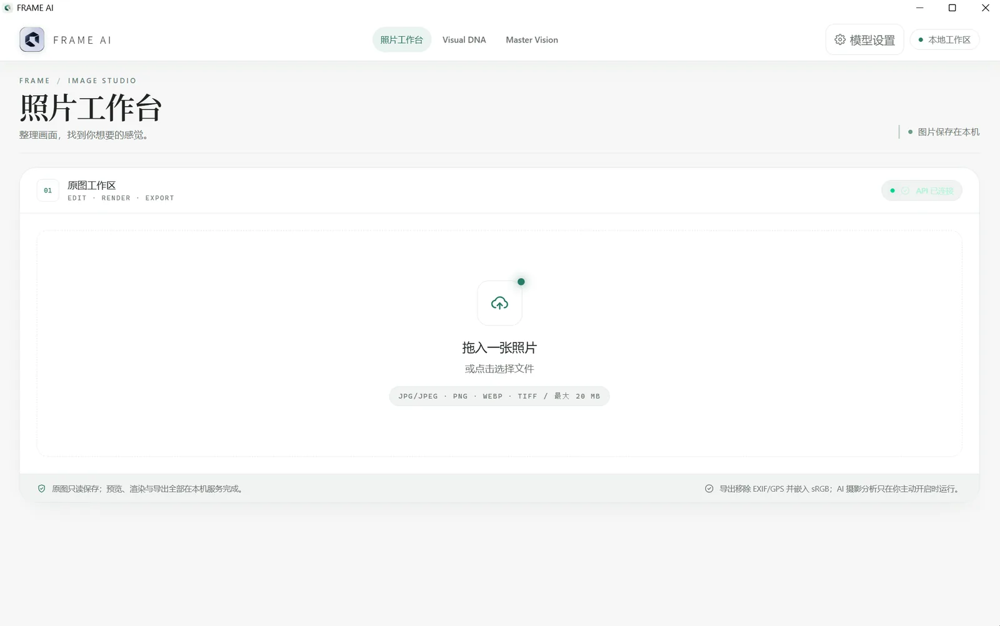
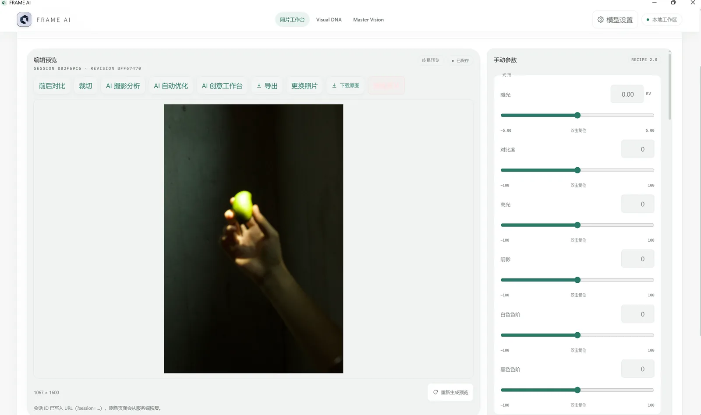
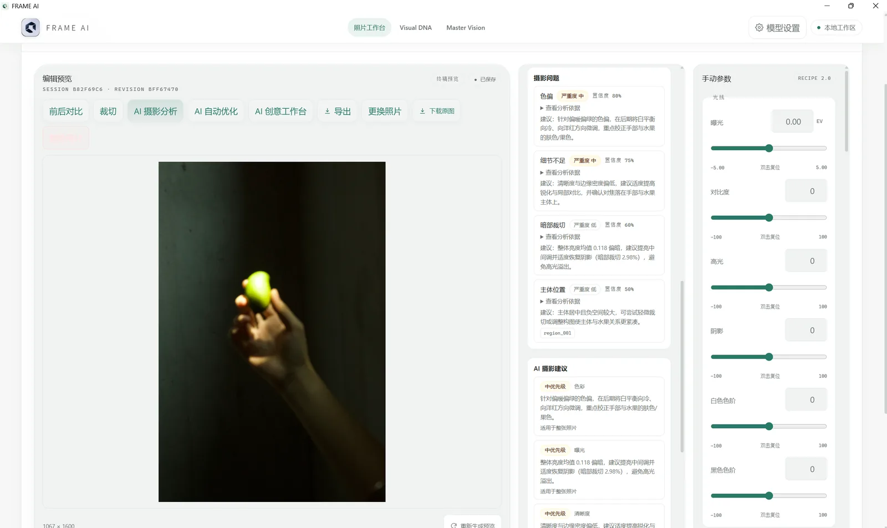
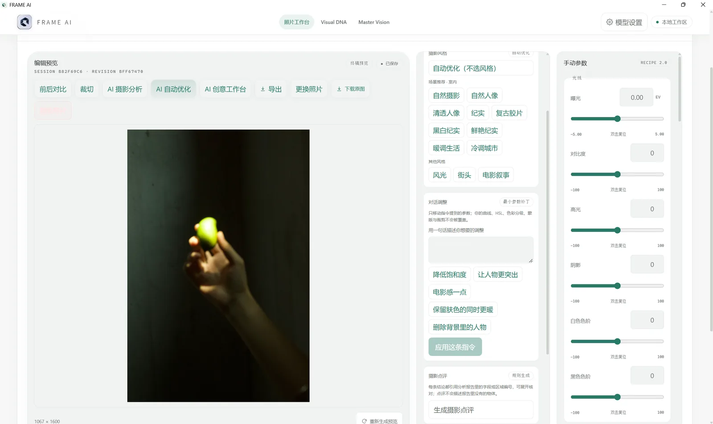
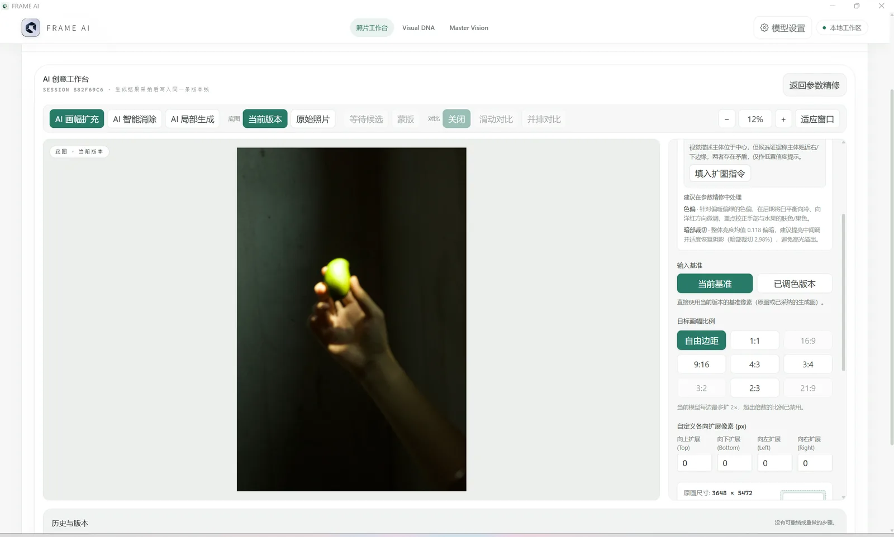
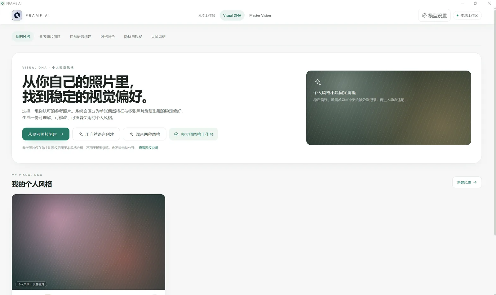
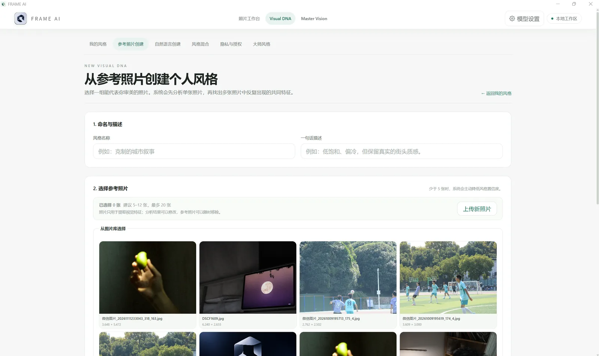
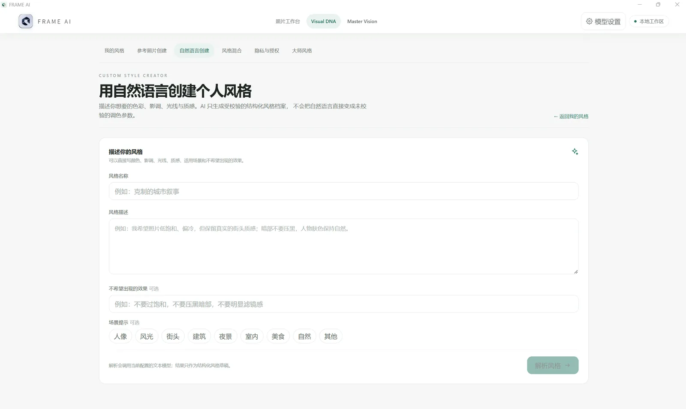
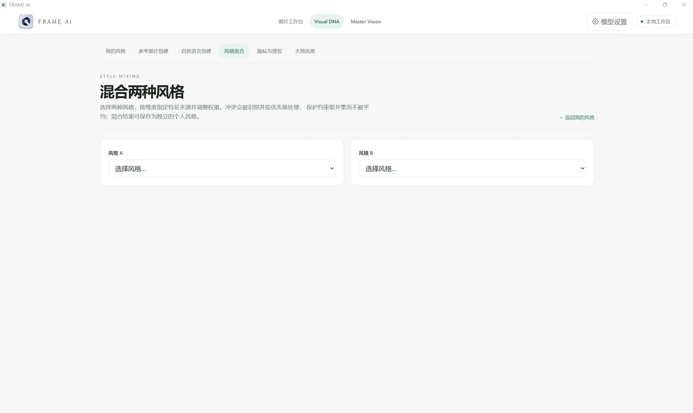
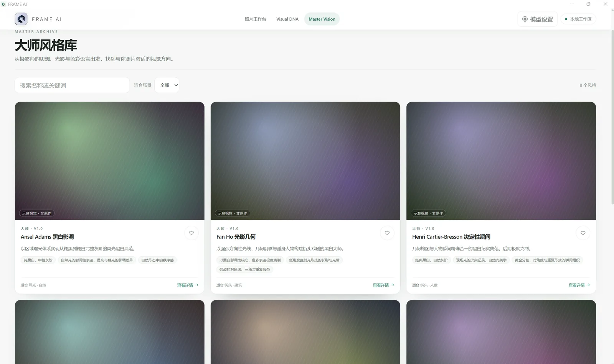

<div align="center">

# FRAME AI 

### 你的私人AI摄影师

整理画面，找到你想要的感觉。

本地优先 · 非破坏编辑 · AI 只给建议，最终决定权在你

</div>

---

## 一张照片，一次完整的后期对话

FRAME AI 不是一个套滤镜的工具。它会先看懂照片里的光线、色彩与主体，再用你能理解的方式给出建议；你决定接受什么、拒绝什么，原图从头到尾不被改写。

从导入到导出，所有操作都围绕同一条版本线展开：**编辑只记录配方，渲染始终从原图重算。**

## 功能一览

| 步骤 | 功能 | 你会得到 |
| --- | --- | --- |
| [01](#01--照片工作台) | 照片工作台 | 拖入即开始，自动建立会话与历史 |
| [02](#02--手动调色每一档都在你手里) | 手动调色 | 从影调到质感的完整参数控制 |
| [03](#03--ai-摄影分析先看懂照片再谈怎么调) | AI 摄影分析 | 问题诊断、置信度与可展开的依据 |
| [04](#04--ai-自动优化与摄影风格说出你想要的感觉) | 自动优化与风格 | 12 种摄影风格、对话式调整与摄影点评 |
| [05](#05--ai-创意工作台不止调色还能改变画面边界) | AI 创意工作台 | 画幅扩充、智能消除、局部生成 |
| [06](#06--visual-dna从你的照片里找到你的风格) | Visual DNA | 属于你自己的可复用个人风格 |
| [07](#07--master-vision与大师对话) | Master Vision | 8 位摄影大师的视觉语言档案 |

---

## 01 · 照片工作台

**拖入一张照片，马上开始。**

不需要注册，也不需要把照片上传到别人的服务器。打开工作台，把照片拖进虚线框，或者点击选择文件。



- 支持 JPG / JPEG / PNG / WebP / TIFF，单张最大 20 MB
- 上传后自动创建编辑会话，每一步保存为可回溯的历史版本
- 图片保存在本机，页面右上角随时确认工作区状态
- 原图只读保存，预览、渲染与导出都在本机服务完成

---

## 02 · 手动调色，每一档都在你手里

**从光线到质感，所有参数都看得见、改得动。**

左侧是预览，右侧是完整的配方参数。拖动滑杆，画面实时更新；双击参数即可复位。



- **光线**：曝光、对比度、高光、阴影、白色色阶、黑色色阶
- **色彩与质感**：色温、色调、饱和度、自然饱和度、清晰度、锐化、降噪、暗角、颗粒
- **构图**：旋转与裁切，支持前后对比、撤销 / 重做 / 重置
- 每次编辑只写入新的 revision，原图字节始终不变
- 按住空格即可查看原图，随时确认改动的分寸

---

## 03 · AI 摄影分析：先看懂照片，再谈怎么调

**不是一句“建议提高亮度”，而是告诉你问题在哪、有多严重、依据是什么。**

点击“AI 摄影分析”，FRAME AI 会检查色偏、细节、暗部裁切、主体位置等问题，并给出对应建议。



- 每个问题标注**严重度**与**置信度**，避免把猜测说成结论
- “查看分析依据”可展开具体测量结果，不藏黑盒
- 建议区分适用范围：整张照片，或 `region_001` 这样的主体区域
- 主体框与区域引用可直接用于后续的局部调整
- 分析只在你主动点击时运行；切换照片会清空旧结果

---

## 04 · AI 自动优化与摄影风格：说出你想要的感觉

**选一个风格，或者说一句话。**

从自然、人像、纪实到电影感，12 种风格覆盖常见拍摄场景；也可以直接用自然语言描述你想调整的方向。



- **12 种摄影风格**：自然摄影、自然人像、清透人像、纪实、复古胶片、黑白纪实、鲜艳纪实、暖调生活、冷调城市、风光、街头、电影叙事
- **自动优化**：不指定风格，让 AI 根据画面给出均衡方案
- **对话调整**：“电影感一点”“保留肤色的同时更暖”“让人物更突出”
- 指令只移动它提到的参数；你手动设置的曲线、HSL、色彩分级、蒙版与裁切不会被覆盖
- **摄影点评**由规则生成、可逐条溯源，只描述画面里真实存在的元素
- 方案先以提案形式展示，接受后才写入普通历史

---

## 05 · AI 创意工作台：不止调色，还能改变画面边界

**当构图差一点，不必重拍。**

画幅扩充、智能消除、局部生成集中在同一个工作台里，生成结果写回同一条版本线。



- **AI 画幅扩充**：自由边距，或 1:1、16:9、9:16、4:3、3:4、3:2、2:3、21:9 等比例
- 支持自定义各方向扩展像素，当前模型每边最多扩展 2 倍
- **AI 智能消除**与**AI 局部生成**：用蒙版指定要处理的区域
- 可选择以当前版本或已调色版本作为输入基准
- 候选结果支持滑动对比、并排对比，满意后再写回版本线

---

## 06 · Visual DNA：从你的照片里，找到你的风格

**不是固定滤镜，而是从多张照片中提炼出的稳定偏好。**

选择一组你认可的照片，系统会区分单张偶然特征与反复出现的共同特征，生成一份可理解、可修改、可复用的个人风格。



### 06.1 从参考照片创建

挑选 5–12 张照片效果最好，最多支持 20 张。照片只用于提取视觉特征，分析结果可以随时修改。



- 少于 5 张时，系统会主动降低风格置信度
- 风格包含命名与一句话描述，便于以后识别和复用
- 参考照片可以随时移除，不会混入最终风格

### 06.2 用自然语言创建

直接描述你想要的色彩、影调、光线与质感，也可以写明不希望出现的效果。



- 自然语言只用于解析结构化风格档案，不会被直接当成未经验证的调色参数
- 可选择场景提示：人像、风光、街头、建筑、夜景、室内、美食、自然等
- 解析结果是一份可检查、可修改的风格草稿

### 06.3 混合两种风格

选择风格 A 与风格 B，按维度指定特征来源并调整权重。



- 冲突会被识别并按优先级处理，保护约束取并集而不是被平均掉
- 混合结果可以保存为独立的个人风格
- 参考照片只在你主动授权后用于本机风格分析，不用于模型训练，也不会自动公开

---

## 07 · Master Vision：与大师对话

**从摄影师的思想、光影与色彩语言出发，而不只是复制一个色调。**

大师风格库收录 8 位摄影师的视觉语言档案，支持按名称搜索、按场景筛选、收藏与查看详情。



- Ansel Adams 黑白影调、Fan Ho 光影几何、Henri Cartier-Bresson 决定性瞬间
- Saul Leiter 色彩街头、Vivian Maier 人文纪实、William Eggleston 日常色彩
- Steve McCurry 环境人像、Hiroshi Sugimoto 极简时间
- 每位大师包含色彩、光线、构图与质感四个维度的可解释描述
- 风格研究为原创整理，不复制或再分发受版权保护的原作

---

## 本地优先，边界清晰

- **原图不被改写**：编辑只记录配方与 revision，导出始终从原图重新渲染
- **数据在本机**：图片、配方与历史默认保存在本机数据目录（开发时为仓库 `data/`，桌面版为 `%APPDATA%\FRAME AI`）
- **AI 不越权**：分析、优化与生成都以提案形式出现，接受后才写入历史
- **请求可控**：只有你主动开启分析或生成、并配置了真实 Provider 时，所选图像才会发送给你指定的模型服务
- **密钥留在服务端**：Provider 密钥保存在本机，使用 AES-256-GCM 加密，不回显到页面、日志或前端构建产物
- **导出干净**：移除 EXIF / GPS 并嵌入 sRGB；PNG / TIFF 支持 8 / 16-bit 与透明通道

---

## 快速开始

**先决条件**

- Node.js 24.19（见 `.nvmrc`）
- Python 3.14.7（见 `.python-version`，代码保持 3.11+ 兼容）
- Windows、macOS 或 Linux

**1. 启动后端**

```powershell
cd services/api
python -m venv .venv
.\.venv\Scripts\Activate.ps1
pip install -r requirements.txt
python -m uvicorn app.main:app --reload --host 127.0.0.1 --port 8000
```

**2. 启动前端**

```bash
cd apps/web
npm ci
npm run dev
```

打开 <http://127.0.0.1:3000>。

**3. 开始使用**

默认使用离线 Mock Provider，无需任何 API Key。需要真实能力时，点击顶栏“模型设置”，填入任意 OpenAI 兼容服务的 Provider、模型名、Base URL 与 API Key 即可。

---

## 技术栈

| 层 | 技术 |
| --- | --- |
| Web 界面 | Next.js 16 · React 19 · Turbopack |
| API 服务 | FastAPI · Pydantic v2 · SQLite |
| 图像处理 | Pillow · NumPy · OpenCV · tifffile |
| 测试 | Pytest · Vitest · Playwright |
| 桌面打包 | PyInstaller · NSIS（Windows） |

## 项目结构

```text
apps/web             Next.js 界面与编辑器
services/api         FastAPI 服务、图像管线与 AI 编排
shared/contracts     OpenAPI 契约与生成类型
docs/                架构、API、色彩、性能与部署文档
scripts/             验证、基准与维护脚本
```

## 延伸阅读

- [API 契约](docs/api-contract.md)
- [系统架构](docs/architecture.md)
- [色彩管理](docs/color-management.md)
- [性能与测量方法](docs/performance.md)
- [备份与恢复](docs/backup-restore.md)
- [已知问题](docs/known-issues.md)

---

## License

本项目采用 [MIT License](LICENSE) 授权。

Copyright (c) 2026 chillBnetley
